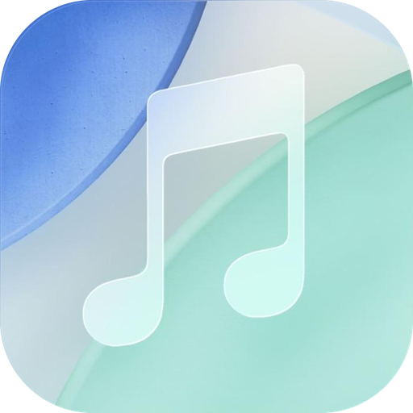

# Glass Player

## ☕ Donate / Buy me a coffee

**Coming soon** — our donation options are on the way.

| Platform | Status |
| --- | --- |
| Paytm | Coming soon |
| PayPal | Coming soon |
| GPay (Google Pay) | Coming soon |

If you like our work, you can support us with a donation. We are bringing this very soon — **coming soon**.

---

## 🌐 Donate / Buy me a coffee — all languages

**Coming soon** · Paytm · PayPal · GPay — all coming soon.

**🇮🇳 Indian languages**

- **Hindi** (हिन्दी): ☕ Donate / Buy me a coffee — जल्द ही आ रहा है। Paytm, PayPal और GPay जल्द ही आ रहे हैं। अगर आपको हमारा काम पसंद है, तो आप डोनेशन देकर हमारा सपोर्ट कर सकते हैं। हम इसे बहुत जल्द ला रहे हैं।
- **Bengali** (বাংলা): ☕ Donate / Buy me a coffee — খুব শিগগিরই আসছে। Paytm, PayPal এবং GPay খুব শিগগিরই আসছে। আমাদের কাজ ভালো লাগলে, আপনি অনুদান দিয়ে আমাদের পাশে দাঁড়াতে পারেন। আমরা খুব তাড়াতাড়ি এটা নিয়ে আসছি।
- **Marathi** (मराठी): ☕ मला कॉफी दान करा / माझ्यासाठी कॉफी विकत घ्या — लवकरच येत आहे. Paytm, PayPal आणि GPay लवकरच येत आहेत. जर तुम्हाला आमचं काम आवडत असेल, तर तुम्ही आम्हाला देणगी देऊन सपोर्ट करू शकता. आम्ही हे लवकरच सुरू करत आहोत.
- **Telugu** (తెలుగు): ☕ నాకు కాఫీ కొనివ్వండి / విరాళం ఇవ్వండి — త్వరలో రాబోతోంది. Paytm, PayPal మరియు GPay త్వరలో రాబోతున్నాయి. మా పని మీకు నచ్చితే, మీరు విరాళం ఇవ్వడం ద్వారా మాకు మద్దతు ఇవ్వవచ్చు. దీన్ని మేము త్వరలోనే తీసుకువస్తున్నాము.
- **Tamil** (தமிழ்): ☕ எனக்கு ஒரு காபி வாங்கிக் கொடுங்கள் / நன்கொடை — விரைவில் வருகிறது. Paytm, PayPal மற்றும் GPay விரைவில் வரவுள்ளன. எங்களுடைய வேலை உங்களுக்குப் பிடித்திருந்தால், நன்கொடை அளித்து நீங்கள் எங்களுக்கு ஆதரவளிக்கலாம். இதை நாங்கள் விரைவில் கொண்டு வருகிறோம்.
- **Gujarati** (ગુજરાતી): ☕ મને કોફી દાન કરો / કોફી ખરીદો — ટૂંક સમયમાં આવી રહ્યું છે. Paytm, PayPal અને GPay ટૂંક સમયમાં આવી રહ્યા છે. જો તમને અમારું કામ ગમે, તો તમે અમને દાન આપીને સપોર્ટ કરી શકો છો. અમે તેને બહુ જલ્દી લાવી રહ્યા છીએ.
- **Kannada** (ಕನ್ನಡ): ☕ ಡೊನೇಟ್ / ನನಗೆ ಒಂದು ಕಾಫಿ ಕೊಡಿಸಿ — ಶೀಘ್ರದಲ್ಲೇ ಬರುತ್ತಿದೆ. Paytm, PayPal ಮತ್ತು GPay ಶೀಘ್ರದಲ್ಲೇ ಬರಲಿವೆ. ನಿಮಗೆ ನಮ್ಮ ಕೆಲಸ ಇಷ್ಟವಾದರೆ, ನೀವು ದೇಣಿಗೆ ನೀಡುವ ಮೂಲಕ ನಮಗೆ ಬೆಂಬಲ ನೀಡಬಹುದು. ನಾವು ಇದನ್ನು ಬಹಳ ಶೀಘ್ರದಲ್ಲೇ ತರುತ್ತಿದ್ದೇವೆ.
- **Malayalam** (മലയാളം): ☕ Donate / Buy me a coffee — ഉടൻ വരുന്നു. Paytm, PayPal, GPay എന്നിവ ഉടൻ വരുന്നു. ഞങ്ങളുടെ വർക്കുകൾ നിങ്ങൾക്ക് ഇഷ്ടമാണെങ്കിൽ, ഒരു സംഭാവന നൽകി ഞങ്ങളെ പിന്തുണയ്ക്കാം. ഞങ്ങൾ ഇത് വളരെ വേഗം കൊണ്ടുവരുന്നുണ്ട്.
- **Odia** (ଓଡ଼ିଆ): ☕ ମୋତେ କଫି କିଣି ଦିଅନ୍ତୁ / ଡୋନେଟ୍ କରନ୍ତୁ — ଖୁବ୍ ଶୀଘ୍ର ଆସୁଛି। Paytm, PayPal ଏବଂ GPay ଖୁବ୍ ଶୀଘ୍ର ଆସୁଛି। ଯଦି ଆପଣଙ୍କୁ ଆମ କାମ ପସନ୍ଦ, ତେବେ ଆପଣ ଆମକୁ ଡୋନେସନ୍ ଦେଇ ସପୋର୍ଟ କରିପାରିବେ। ଆମେ ଏହାକୁ ଖୁବ୍ ଶୀଘ୍ର ଆଣିବୁ।
- **Punjabi** (ਪੰਜਾਬੀ): ☕ ਮੈਨੂੰ ਕੌਫੀ ਦਾਨ ਕਰੋ / ਮੇਰੇ ਲਈ ਕੌਫੀ ਖਰੀਦੋ — ਜਲਦੀ ਆ ਰਿਹਾ ਹੈ। Paytm, PayPal ਅਤੇ GPay ਜਲਦੀ ਆ ਰਹੇ ਹਨ। ਜੇਕਰ ਤੁਹਾਨੂੰ ਸਾਡਾ ਕੰਮ ਪਸੰਦ ਹੈ, ਤਾਂ ਤੁਸੀਂ ਦਾਨ ਦੇ ਕੇ ਸਾਡਾ ਸਾਥ ਦੇ ਸਕਦੇ ਹੋ। ਅਸੀਂ ਇਸਨੂੰ ਬਹੁਤ ਜਲਦੀ ਲੈ ਕੇ ਆ ਰਹੇ ਹਾਂ।
- **Assamese** (অসমীয়া): ☕ Donate / Buy me a coffee — অতি সোনকালেই আহি আছে। Paytm, PayPal আৰু GPay অতি সোনকালেই আহি আছে। যদি আপুনি আমাৰ কাম ভাল পায়, তেন্তে আপুনি দান কৰি আমাক সহায় কৰিব পাৰে। আমি এইটো অতি সোনকালেই লৈ আহি আছোঁ।
- **Urdu** (اردو): ☕ مجھے کافی ڈونیٹ / خریدیں — جلد آرہا ہے۔ Paytm، PayPal اور GPay جلد آرہے ہیں۔ اگر آپ کو ہمارا کام پسند ہے، تو آپ ڈونیشن دے کر ہماری مدد کر سکتے ہیں۔ ہم اسے بہت جلد لا رہے ہیں۔
- **Nepali** (नेपाली): ☕ मलाई कफी किनिदिनुहोस् / दान गर्नुहोस् — छिट्टै आउँदैछ। Paytm, PayPal र GPay पनि छिट्टै आउँदैछन्। यदि तपाईंलाई हाम्रो काम मन पर्छ भने, तपाईंले हामीलाई दान गरेर सहयोग गर्न सक्नुहुन्छ। हामी यो सुविधा धेरै चाँडै ल्याउँदैछौं।
- **Sanskrit** (संस्कृतम्): ☕ मह्यं काफीं क्रीणन्तु / दानं कुर्वन्तु — शीघ्रमेव आगच्छति। Paytm, PayPal तथा GPay अपि शीघ्रमेव आगच्छन्ति। यदि भवन्तः अस्माकं कार्यं रोचन्ते, तर्हि दानं कृत्वा अस्मान् समर्थयितुं शक्नुवन्ति। वयं तत् शीघ्रमेव आनयामः।
- **Konkani** (कोंकणी): ☕ म्हाका कॉफी दान करात / म्हजे खातीर कॉफी घेयात — रोखडेंच येता. Paytm, PayPal आनी GPay रोखडेंच येतले. तुमकां आमचें काम आवडल्यार, तुमी आमकां देणगी दिवन आदार करूंक शकतात. आमी तें खूब बेगीन हाडटात.
- **Maithili** (मैथिली): ☕ हमरा लेल कॉफी डोनेट करू / खरीदू — जल्दिये आबि रहल अछि। Paytm, PayPal आ GPay जल्दिये आबि रहल अछि। जँ अहाँकेँ हमर काज नीक लागैत अछि, तँ अहाँ दान कऽ कऽ हमर समर्थन कऽ सकैत छी। हम एकरा बहुत जल्दी लाबि रहल छी।
- **Kashmiri** (کٲشُر): ☕ مےٚ دِیِو اَکھ کافی — جَلدی یِوان چھُ۔ Paytm, PayPal تہٕ GPay چھِ جَلدی یِوان۔ اَگر تُہؠ سٲنؠ کٲم پَسَند چھِو کَران، تُہؠ ہیٚکِو اَسے اَکھ ڈونیشَن دِتھ سَپورٹ کٔرِتھ۔ اَسؠ چھِ یہِ واریاہ جَلدی اَنان۔
- **Sindhi** (سنڌي): ☕ डोनेट / मूंखे हिक कॉफी वठायो — जल्द अची रह्यो आहे। Paytm, PayPal ऐं GPay जल्द अची रह्या आहिन। जेकडहिं तव्हां खे असां जो कमु वणंदो आहे, त तव्हां असां खे डोनेशन डई सपोर्ट करे सघो था। असीं इहो डाढो जल्द आणी रह्या आहियूं।
- **Dogri** (डोगरी): ☕ डोनेट / मेरे लेई इक कॉफी खरीदो — जल्दी आ करदा ऐ। Paytm, PayPal ते GPay जल्दी आ करदे न। जेकर तुसेंगी साढ़ा कम्म पसंद ऐ, तां तुस साढ़ी मदद दान देइयै करी सकदे ओ। अस इसगी बड़ा जल्दी लेई आ करदे आं।
- **Manipuri** (ꯃꯤꯇꯩ ꯂꯣꯟ): ☕ ꯗꯣꯅꯦꯠ / ꯑꯩꯉꯣꯟꯗꯥ ꯀꯣꯐꯤ ꯑꯃꯥ ꯂꯩꯕꯤꯔꯛꯎ — ꯑꯊꯨꯕꯥ ꯃꯇꯝꯗꯥ ꯂꯥꯛꯀꯅꯤ꯫ Paytm, PayPal ꯑꯃꯁꯨꯡ GPay ꯑꯊꯨꯕꯥ ꯃꯇꯝꯗꯥ ꯂꯥꯛꯀꯅꯤ꯫ ꯀꯔꯤꯒꯨꯝꯕꯥ ꯅꯈꯣꯌꯅꯥ ꯑꯩꯈꯣꯌꯒꯤ ꯊꯕꯛ ꯑꯁꯤ ꯄꯥꯝꯂꯕꯗꯤ, ꯅꯈꯣꯌꯅꯥ ꯗꯣꯅꯦꯁꯟ ꯑꯃꯒꯥ ꯂꯣꯌꯅꯅꯥ ꯑꯩꯈꯣꯌꯕꯨ ꯃꯇꯦꯡ ꯄꯥꯡꯕꯤꯕꯥ ꯌꯥꯏ꯫ ꯑꯩꯈꯣꯌꯅꯥ ꯃꯁꯤ ꯑꯊꯨꯕꯥ ꯃꯇꯝꯗꯥ ꯄꯨꯔꯛꯂꯤ꯫
- **Bodo** (बर’): ☕ आंनो कफि बायना हो — थाबैनो फैगोन। Paytm, PayPal आरो GPay आ थाबैनो फैगोन। जुदि नोंथांमोना जोंनि हाबाखौ मोजां मोनो, नोंथांमोना जोंखौ दान होनानै मदद खालामनो हागोन। जों बेखौ थाबैनो लाबोगोन।
- **Santali** (ᱥᱟᱱᱛᱟᱲᱤ): ☕ ᱫᱟᱱ / ᱤᱧ ᱢᱤᱫ ᱠᱚᱯᱷᱤ ᱠᱤᱨᱤᱧ ᱤᱧ — ᱞᱚᱜᱚᱱ ᱦᱤᱡᱩᱜ ᱠᱟᱱᱟ᱾ Paytm, PayPal ᱟᱨ GPay ᱞᱚᱜᱚᱱ ᱦᱤᱡᱩᱜ ᱠᱟᱱᱟ᱾ ᱡᱩᱫᱤ ᱟᱞᱮᱭᱟᱜ ᱠᱟᱹᱢᱤ ᱯᱮ ᱠᱩᱥᱤᱭᱟᱜ ᱠᱟᱱᱟ, ᱮᱱᱠᱷᱟᱱ ᱫᱟᱱ ᱠᱟᱛᱮ ᱟᱞᱮ ᱜᱚᱲᱚ ᱫᱟᱲᱮᱭᱟᱯᱮᱭᱟ ᱯᱮ᱾ ᱟᱞᱮ ᱱᱚᱶᱟ ᱟᱹᱰᱤ ᱞᱚᱜᱚᱱ ᱞᱮ ᱟᱹᱜᱩᱭᱮᱫᱟ᱾

**🌍 Global languages**

- **Spanish** (Español): ☕ Donar / Invítame un café — Muy pronto. Paytm, PayPal y GPay estarán disponibles muy pronto. Si te gusta nuestro trabajo, puedes apoyarnos con una donación. Lo estamos lanzando muy pronto.
- **French** (Français): ☕ Faire un don / Offrez-moi un café — Bientôt disponible. Paytm, PayPal et GPay arrivent très bientôt. Si vous aimez notre travail, vous pouvez nous soutenir avec un don. Nous le mettons en place très bientôt.
- **German** (Deutsch): ☕ Spenden / Spendier mir einen Kaffee — Bald verfügbar. Paytm, PayPal und GPay kommen sehr bald. Wenn dir unsere Arbeit gefällt, kannst du uns mit einer Spende unterstützen. Wir bringen es sehr bald.
- **Portuguese** (Português): ☕ Doar / Pague-me um café — Em breve. Paytm, PayPal e GPay chegam em breve. Se você gosta do nosso trabalho, pode nos apoiar com uma doação. Estamos trazendo isso muito em breve.
- **Italian** (Italiano): ☕ Dona / Offrimi un caffè — In arrivo. Paytm, PayPal e GPay arrivano presto. Se ti piace il nostro lavoro, puoi sostenerci con una donazione. Lo stiamo lanciando molto presto.
- **Dutch** (Nederlands): ☕ Doneer / Trakteer me op een koffie — Binnenkort beschikbaar. Paytm, PayPal en GPay komen binnenkort. Als je ons werk leuk vindt, kun je ons steunen met een donatie. We brengen dit heel binnenkort.
- **Polish** (Polski): ☕ Przekaż datek / Postaw mi kawę — Wkrótce. Paytm, PayPal i GPay już wkrótce. Jeśli podoba Ci się nasza praca, możesz nas wesprzeć datkiem. Wprowadzamy to bardzo szybko.
- **Russian** (Русский): ☕ Пожертвовать / Купи мне кофе — Скоро. Paytm, PayPal и GPay появятся совсем скоро. Если вам нравится наша работа, вы можете поддержать нас пожертвованием. Мы запускаем это очень скоро.
- **Ukrainian** (Українська): ☕ Пожертвувати / Купи мені каву — Незабаром. Paytm, PayPal і GPay з'являться дуже скоро. Якщо вам подобається наша робота, ви можете підтримати нас пожертвою. Ми запускаємо це дуже скоро.
- **Turkish** (Türkçe): ☕ Bağış yap / Bana bir kahve ısmarla — Çok yakında. Paytm, PayPal ve GPay çok yakında geliyor. İşimizi beğendiyseniz bağışla bizi destekleyebilirsiniz. Çok yakında sunuyoruz.
- **Arabic** (العربية): ☕ تبرّع / اشترِ لي قهوة — قريبًا. Paytm وPayPal وGPay ستتوفر قريبًا جدًا. إذا أعجبك عملنا، يمكنك دعمنا بالتبرع. نطرحه قريبًا جدًا.
- **Persian** (فارسی): ☕ کمک مالی / برایم یک قهوه بخر — به‌زودی. Paytm، PayPal و GPay به‌زودی اضافه می‌شوند. اگر کار ما را دوست دارید، می‌توانید با یک کمک مالی از ما حمایت کنید. این قابلیت را خیلی زود اضافه می‌کنیم.
- **Hebrew** (עברית): ☕ תרומה / קנו לי קפה — בקרוב. Paytm, PayPal ו-GPay יגיעו בקרוב מאוד. אם אתם אוהבים את העבודה שלנו, תוכלו לתמוך בנו בתרומה. אנחנו מביאים את זה בקרוב מאוד.
- **Indonesian** (Bahasa Indonesia): ☕ Donasi / Traktir saya kopi — Segera hadir. Paytm, PayPal, dan GPay segera hadir. Jika Anda menyukai karya kami, Anda dapat mendukung kami dengan donasi. Kami akan menghadirkannya segera.
- **Malay** (Bahasa Melayu): ☕ Derma / Belanja saya kopi — Akan datang. Paytm, PayPal dan GPay akan datang tidak lama lagi. Jika anda suka hasil kerja kami, anda boleh menyokong kami dengan derma. Kami akan membawanya tidak lama lagi.
- **Vietnamese** (Tiếng Việt): ☕ Quyên góp / Mời tôi một ly cà phê — Sắp ra mắt. Paytm, PayPal và GPay sẽ sớm ra mắt. Nếu bạn thích công việc của chúng tôi, bạn có thể ủng hộ bằng một khoản quyên góp. Chúng tôi sẽ sớm mang tính năng này đến.
- **Thai** (ไทย): ☕ บริจาค / เลี้ยงกาแฟฉันสักแก้ว — เร็ว ๆ นี้ Paytm, PayPal และ GPay กำลังจะมาเร็ว ๆ นี้ หากคุณชอบผลงานของเรา คุณสามารถสนับสนุนเราด้วยการบริจาค เรากำลังจะเปิดให้ใช้เร็ว ๆ นี้
- **Japanese** (日本語): ☕ 寄付 / コーヒーをおごる — 近日公開。Paytm、PayPal、GPay も近日対応予定です。私たちの仕事を気に入っていただけたら、寄付で支援できます。まもなく公開します。
- **Korean** (한국어): ☕ 후원 / 커피 한 잔 사주기 — 곧 공개됩니다. Paytm, PayPal, GPay도 곧 지원됩니다. 저희 작업이 마음에 드신다면 후원으로 지원하실 수 있습니다. 곧 선보이겠습니다.
- **Chinese (Simplified)** (简体中文): ☕ 捐赠 / 请我喝杯咖啡 — 即将推出。Paytm、PayPal 和 GPay 即将上线。如果你喜欢我们的作品，可以通过捐赠支持我们。我们很快就会推出。
- **Chinese (Traditional)** (繁體中文): ☕ 捐贈 / 請我喝杯咖啡 — 即將推出。Paytm、PayPal 和 GPay 即將上線。如果你喜歡我們的作品，可以透過捐贈支持我們。我們很快就會推出。
- **Greek** (Ελληνικά): ☕ Δωρεά / Κέρασέ με έναν καφέ — Έρχεται σύντομα. Paytm, PayPal και GPay έρχονται σύντομα. Αν σας αρέσει η δουλειά μας, μπορείτε να μας στηρίξετε με μια δωρεά. Το φέρνουμε πολύ σύντομα.
- **Czech** (Čeština): ☕ Darovat / Kup mi kávu — Již brzy. Paytm, PayPal a GPay budou brzy k dispozici. Pokud se vám naše práce líbí, můžete nás podpořit darem. Přinášíme to velmi brzy.
- **Romanian** (Română): ☕ Donează / Cumpără-mi o cafea — În curând. Paytm, PayPal și GPay vor fi disponibile în curând. Dacă îți place munca noastră, ne poți susține cu o donație. O aducem foarte curând.
- **Hungarian** (Magyar): ☕ Adományozás / Hívj meg egy kávéra — Hamarosan. A Paytm, a PayPal és a GPay hamarosan elérhető. Ha tetszik a munkánk, adománnyal támogathatsz minket. Nagyon hamarosan elhozzuk.
- **Swedish** (Svenska): ☕ Donera / Bjud mig på en kaffe — Kommer snart. Paytm, PayPal och GPay kommer snart. Om du gillar vårt arbete kan du stötta oss med en donation. Vi lanserar det mycket snart.
- **Danish** (Dansk): ☕ Donér / Køb en kaffe til mig — Kommer snart. Paytm, PayPal og GPay kommer snart. Hvis du kan lide vores arbejde, kan du støtte os med en donation. Vi kommer med det meget snart.
- **Norwegian** (Norsk): ☕ Doner / Kjøp en kaffe til meg — Kommer snart. Paytm, PayPal og GPay kommer snart. Hvis du liker arbeidet vårt, kan du støtte oss med en donasjon. Vi lanserer det svært snart.
- **Finnish** (Suomi): ☕ Lahjoita / Tarjoa minulle kahvi — Tulossa pian. Paytm, PayPal ja GPay tulevat pian. Jos pidät työstämme, voit tukea meitä lahjoituksella. Tuomme sen hyvin pian.
- **Swahili** (Kiswahili): ☕ Changia / Ninunulie kahawa — Inakuja hivi karibuni. Paytm, PayPal na GPay zinakuja hivi karibuni. Ikiwa unapenda kazi yetu, unaweza kutusaidia kwa mchango. Tunaileta hivi karibuni.
- **Filipino** (Filipino): ☕ Mag-donate / Bilhan mo ako ng kape — Malapit na. Paparating na ang Paytm, PayPal at GPay. Kung gusto mo ang aming gawa, matutulungan mo kami sa pamamagitan ng donasyon. Ilalabas namin ito sa lalong madaling panahon.

---

## Screenshots

| Now playing | Playlist | Settings |
|:---:|:---:|:---:|
|  |  |  |

**4D depth** — the card tilts with the device while the layers drift at different rates:


## Features

- **Liquid glass card** — layered translucency, 28px backdrop blur, saturate boost, inset
  highlights and a diagonal sheen, all sitting on three drifting colour blobs.
- **Colour follows the song** — every track carries a hue; the album art, the blob field and the
  glass tint shift together, and the hue is adjustable live from the options sheet.
- **Real audio** — pick any audio file from your phone with the system file picker. Nothing is
  uploaded anywhere; playback is local.
- **Spring animations** — the player pops in from the bottom, collapses into a floating bubble on
  close, and the album art wipes sideways with a blur when you change track.
- **Playlist** — tap a row to jump to a track, the current row shows an animated equaliser.
- **4D depth** — the card behaves like a physical object. It tilts with the phone's gyroscope
  (or with your finger on the artwork), the art, title, transport and playlist slide at different
  rates, the drop shadow swings to the opposite side, and a specular highlight travels across the
  glass as you move. It also sways gently on its own when you leave it alone.
- **A settings panel for all of it** — depth, tilt range, parallax, light and shadow are each
  adjustable with live preview, alongside a Motion switch (Auto / Touch / Off) and an idle-drift
  toggle. Transparency, blur and colour shift live there too, and every setting is remembered
  across launches.
- **Light and dark** — follows the system theme, and the dark theme is the signature look.

## Install

1. Download `GlassPlayer.apk` from the [releases page](https://github.com/technicalnihilist-lgtm/iOS-music/releases/latest).
2. On your phone, open the file and allow "install from unknown sources" for your browser or file manager.
3. Launch **Glass Player**, tap **Add songs** and pick audio files from your device.

The APK is signed with a self-signed debug key, so Play Protect may ask you to confirm the install.

## Project layout

```
source/index.html                 the entire player UI (HTML + CSS + JS)
android/app/src/main/assets/      the same file, shipped inside the APK
android/app/src/main/java/         MainActivity: full-screen WebView host
android/app/src/main/res/          manifest resources, layout, launcher icon
android/build.sh                   builds and signs the APK without Gradle
```

## Build it yourself

You need JDK 17 and the Android SDK (platform 34 + build-tools 34.0.0). No Gradle required —
the build script drives `aapt2`, `javac`, `d8`, `zipalign` and `apksigner` directly.

```bash
export ANDROID_SDK_ROOT=/path/to/android-sdk
bash android/build.sh
# -> android/app/build/GlassPlayer.apk
```

To change the UI, edit `source/index.html`, copy it to
`android/app/src/main/assets/index.html`, and rebuild.

## Changelog

### 9.0 — the seek drag now invalidates the value cache `ontimeupdate` compares against

- `tuCache` exists so `ontimeupdate` can skip writes it has already made, and its own comment requires every other writer of those three nodes to reset it; `sk.oninput` wrote `#seek`'s `--p` and `value` and `#cur` and left the pre-drag values cached, so with no usable duration the next tick compared against a state the DOM no longer held and skipped the write it owed, leaving the bar at `70%`/`70` while the clock counted on (measured on 8.9 with `duration` `Infinity`: still `70%`/`70` after 600 ms of ticks; on 9.0 it returns to `0%`/`0`, and with a usable duration the tick rewrites exactly what the drag wrote, so nothing visible changes), markup and stylesheet byte-identical to 8.9 and the harness reporting the same picking, dedupe, row reuse, settings write, back chain and flat/tilted hit-tests.

### 8.9 — a `play()` the page itself superseded no longer reports "Can't play this file"

- `playRefused()` treated every rejection of `au.play()` except `NotAllowedError`/`SecurityError` as a failure of the file, but the element also rejects with `AbortError` whenever a request is superseded by a new load request or a `pause()` — both of which this page does on every track change and every deliberate pause — so a fast Next left `data-blocked="1"` and the off-screen status region announcing "Can't play this file" over a player that was playing, and dropped the 700 ms swap window the new source had just armed (`swapAt` `null` 150 ms after the tap); `AbortError` is now ignored outright and each attempt carries a token so a rejection from a superseded attempt cannot speak for the track that replaced it (measured on 8.8: `data-blocked` `"1"`, `#live` "Can't play this file", still `"1"` 2.5 s later, over `playing` true / `au.paused` false; on 8.9: `"0"` and empty, with `swapping()` still true), the give-up path is unchanged (three `error` events still end at `blocked` `"1"`, `stopped` true and "Stopped after 3 unplayable tracks. Can't play this file." on both), the markup and stylesheet are byte-identical to 8.8 and the harness reports the same picking, dedupe, row reuse, settings write, back chain, play/pause and flat/tilted hit-tests.

### 8.8 — the seek bar no longer announces a position it does not hold when the media reports no usable duration

- With a source whose `duration` reads `Infinity` (some VBR MP3s and streams until their header is reparsed) or `NaN` (before metadata), `ontimeupdate` wrote `#cur` and the slider's `aria-valuetext` from `currentTime` while the bar itself stayed at `0` — a clock counting under a bar pinned at the far left, announcing `1:35` from a control holding `0`; a new `setSeekAvail()` marks the slider `aria-disabled="true"` and drops `aria-valuetext` while the duration is unusable, restores both with the real position the moment `showDur()` or a `timeupdate` sees a finite positive duration, and `resetSeek()` re-applies it for a new or emptied playlist (measured on 8.7: `aria-valuetext` `1:35`, `aria-disabled` `null`; on 8.8: absent and `"true"`, with `#cur` still `1:35`, `#dur` `--:--`, `value` `0` and `--p` `0%` on both, and both restoring to `39.6`/`39.583%`/`1:35`/`4:00` once a 240 s duration arrives), the markup and stylesheet are byte-identical to 8.7 and the harness reports the same picking, dedupe, row reuse, settings write, back chain and flat/tilted hit-tests.

### 8.7 — `data-blocked` now has two states, not three, so a fresh page matches `[data-blocked="0"]`

- `setBlocked()` wrote the attribute only when the value changed and `blocked` started `false`, so a page that had never refused a play carried no `data-blocked` at all while one that refused and then recovered carried `"0"` — three spellings for a boolean, and a `[data-blocked="0"]` selector silently missed the fresh page; the attribute is now written once at startup, before anything can refuse a play, so it only ever holds `"0"` or `"1"` (measured on 8.6: `null` on a fresh page and `app.matches('[data-blocked="0"]')` false; on 8.7: `"0"` for both, `"1"` under a stubbed `NotAllowedError` and back to `"0"` after a play that succeeds), the markup and stylesheet are byte-identical to 8.6 and the harness reports the same picking, dedupe, row reuse, settings write, back chain, play/pause and flat/tilted hit-tests.

### 8.6 — `prefers-reduced-motion` now shortens every transition, not just every animation

- The reduced-motion block's blanket rule names `animation-duration` only, so with "Remove animations" on the album art still sprang from 0.84 to 1 over 0.7 s on play, every chip, playlist row and pill still squished over 0.45 s on a press, the drift switch's knob still slid over 0.35 s, the colour-shift slider's thumb still swelled over 0.3 s and the backdrop hue still swept over 1 s on a track change — measured in headless Chromium with `--force-prefers-reduced-motion` on 8.5, the computed `transition-duration` of eleven selectors was identical to the page without the preference; the block now shortens `transition-duration` the same way on `*`, `*::before`, `*::after` and the slider's `::-webkit-slider-thumb` (a pseudo-element is not matched by `*`), the `<script>` block is byte-identical to 8.5 and the behaviour harness reports the same picking, dedupe, row reuse, settings write, back chain and flat/tilted hit-tests while a twenty-selector computed-style diff goes from "no transition shortened" to "every transition at 0.01 s" with the animations, transforms and layout unchanged.

### 8.5 — `Reset defaults` now puts the Colour shift slider and the hue it drives back on the current track, instead of leaving a dragged hue applied until the next track change

- The colour-shift slider is the one control in the sheet that is not part of `S` — the track owns it — so `resetBtn` re-syncing the seven sliders in `SL` skipped it and a hue dragged off the track's own survived the reset (the slider, its readout and `--h` — the blob field and the glass tint — all stayed shifted, and on an empty player it stayed on the dragged hue instead of the 250 the page starts with); the four writes are now one `setHue()` that the drag, `paintTrack()` and the reset all go through, so the reset restores the hue a track change would, the markup and stylesheet are byte-identical to 8.4, and the harness reports the same picking, dedupe, row reuse, settings write, back chain and flat/tilted hit-tests while the reset check goes from "stays at 100" to "back to 138" (and "back to 250" with no track).

### 8.4 — a playlist the platform cannot decode now stops walking it, instead of looping forever

- `au.onplay` cleared the skip chain's failure budget, but `play` fires as soon as `play()` is called — before a byte is loaded, and for a source that is about to fail as well — so `fails` could never reach `MAX_SKIP` and an all-undecodable playlist swapped sources forever (19 errors in 1.5 s, 48 by three seconds on 8.3, CPU busy for as long as the app was open, the card still reading "No songs yet" over three files that were in `tracks`); the budget is now cleared on `playing`, which only a source with data actually advancing reaches, so the same three files stop after 3 errors and report "Stopped after 3 unplayable tracks. Can't play this file." with the failing track named, the markup and stylesheet are byte-identical to 8.3, and the harness reports the same picking, dedupe, row reuse, settings write, back chain and flat/tilted hit-tests while the unplayable-playlist check goes from "never settles" to "settles at 3 errors".

### 8.3 — the settings writer is now one function, so a toggle after a slider drag no longer writes twice

- `saveS()` carried its own copy of `writeS()`'s serialise-and-store body and never cleared `saveTimer`, so a discrete toggle (a motion mode, the drift switch, `Reset defaults`) made while a slider drag's 200 ms debounce was still armed wrote `glass.settings.v1` twice - once immediately and once with the same bytes on the timer - and any change to the key or the serialisation had to be made in both copies; `saveS()` now cancels the pending timer and writes through `writeS()`, the one writer, the markup and stylesheet are byte-identical to 8.2, and the harness reports the same picking, dedupe, row reuse, back chain and flat/tilted hit-tests while a write counter reads 1 write after a drag-then-toggle where 8.2 read 2.

### 8.2 — a reduced-motion setting changed while the player is open now reaches the 4D engine

- `prefers-reduced-motion` was read once when the script first ran and cached in `REDUCED`, while the stylesheet's own media block is re-evaluated the moment the setting changes - so turning "Remove animations" off left the card flat and deaf to the gyroscope, the finger and the pointer until the app was restarted, and turning it on left the spring running frames the stylesheet was overriding; the query is now kept as a live `MediaQueryList` whose `change` event updates the cached answer (and settles the card flat when motion turns off), the markup and stylesheet are byte-identical to 8.1, a side-by-side computed-style/rect snapshot of both builds in one process shows 0 differences across all 127-141 elements in five states, and the harness reports the same picking, dedupe, row reuse, settings write, back chain and flat/tilted hit-tests.

### 8.1 — a source swap that was still settling when the app went to the background is no longer painted as a stop on resume

- the 700 ms swap guard was a flag cleared by a timer that the WebView freezes with the activity, so `visibilitychange` cleared it by hand and the swap's own queued pause was then read as the listener's on resume - dropping `playing`, abandoning audio focus and telling the media notification the player had stopped over a track that was playing; it is now a timestamp read when the pause arrives, the hide no longer touches it, and the markup, stylesheet, computed-style hash (`8fdb8105`), behaviour harness and flat/tilted hit-tests are unchanged from 8.0.

### 8.0 — three declarations that were written twice are now written once

- `.bubble` carried `border-radius:50%` twice in the same rule, `.blobs` was declared in two blocks a hundred lines apart (position and filter in one, the 4D `transform` in the other) and `prefers-reduced-motion` was handled by two blocks that could not see each other - which is how the two runaway loops in 7.8 went unnoticed - so the duplicate declarations are merged and the reduced-motion rules now live in one block; the computed-style/rect hash of all 150 elements (player `86fd53a3`, sheet `c4990f92`, reduced motion `6696717e`/`9156c74b`) and the rendered 412x892 frame at deviceScaleFactor 2 are byte-identical to 7.9, and the harness reports the same picking, dedupe, row reuse, settings write, back chain and flat/tilted hit-tests.

### 7.9 — the skip chain's failure budget counts consecutive failures again, not a lifetime total

- `fails` was cleared only by the callback `load()` handed to `attemptPlay()` and only on a load that asked for autoplay, so a track started by the transport left the counter where the last failure put it: two unplayable files, then one that plays, then a single bad one reached the budget of three and announced "Stopped after 3 unplayable tracks." over a playlist with one bad entry; it is now cleared in `au.onplay`, the one place a source has demonstrably started, the dead `onOk` plumbing is gone with it, and the harness shows the same behaviour everywhere else with real media in the skip chain (two bad files and a real WAV: 7.8 read `fails: 2` once the good track played and gave up on the next single failure, 7.9 reads `fails: 0` and walks past it).

### 7.8 — reduced motion stops the two endless loops instead of running them a hundred times a second

- `prefers-reduced-motion` shortened every animation to 0.01s but left `infinite` on the 14s blob float and the 0.9s equaliser, turning both into 100Hz loops in the one mode meant to remove motion; they are now stopped, the equaliser keeps a static 16px height so the playing row still reads as playing, and the stylesheet outside the media query is byte-identical, with the computed-style/rect hash and the rendered frame matching 7.7 in the player and sheet states.

### 7.7 — five duplicated node handles collapse into the ones the page already cached

- the colour-shift slider, the artwork box and the sway wrapper each kept a second handle to a node the page already holds (`$('hu')` beside `EL.hu`, `$('art')` beside `EL.art`, `.drift` under both `driftEl` and `driftField`), the picker's handler re-resolved `#file`, and `openApp()` looked up `#closeBtn` on every reopen from the bubble; every site now points at the existing handle, `#closeBtn`, `#addBtn` and `#resetBtn` join the startup cache beside `#file`/`#next`/`#prev`/`#optBtn`, and nothing on screen moves — the markup and stylesheet are byte-identical outside the script, and the computed-style/rect hash and the rendered frame match 7.6 in the player, playlist and sheet states.

### 7.6 — a player that gives up on unplayable files tells the lock screen it stopped

- the skip chain's give-up branch painted the stop and told the Android shell to drop audio focus, but it never wrote `navigator.mediaSession.playbackState` — the one stop in the page that fires no pause event of its own — so the lock screen and the media notification kept showing "playing" over a player that had already stopped; that write now goes through a single `setSessionPlaying()` helper beside `setShellPlaying()`, used by `onplay`, `onpause`, the refused-play path and the give-up branch, so the state reads "paused" the moment the chain stops, an ordinary play/pause still reports playing and paused, and the rendered frame is identical pixel for pixel.

### 7.5 — the playlist and the card header are sections a screen reader can name and jump to

- `#list` was an unnamed `role="list"` and the visible "Playlist" above it was a plain `div`, so the accessibility tree exposed a list with no name and no heading to jump to, and "Now Playing" was a plain `b`; the two labels now carry `role="heading" aria-level="2"` and the list is named by its own label, so the tree reads "Now Playing", the track title and "Playlist" as three level-2 headings with the list named "Playlist", while no attribute is rendered, no stylesheet selects on them, and the rendered frame is identical pixel for pixel in the player, playlist and sheet states.

### 7.4 — each settings slider keeps one accessible name while it moves

- every slider sat inside a `<label>` whose text included its own numeric readout, so its computed name changed on every step of a drag ("Transparency 18%" became "Transparency 40%") and a screen reader re-announced a new name over the value it was reading; each of the eight range inputs now carries a static `aria-label` with just the control's name, the reading stays on `aria-valuetext`, and the rendered frame is identical pixel for pixel.

### 7.3 — a file that will not play no longer starts the next one behind a pause

- `au.onerror`'s skip chain re-loaded the next track with a hard `true` for autoplay, so a listener who had paused and then pressed Next onto a file the platform cannot decode had the player walk past it and start the following track out loud; the chain now re-loads with the intent the transport was last given, so a paused player stays paused (and a press on play starts it) while a playing one still skips through and keeps playing, `ended`, a row tap and the give-up message are unchanged, and the rendered frame is identical pixel for pixel.

### 7.2 — the settings sheet takes the player behind it out of the accessibility tree

- the sheet is declared `aria-modal` and traps Tab, but the card behind the scrim stayed in the accessibility tree, so a screen reader in browse mode could still read and activate `#pp`, `#next`, `#prev` and the playlist rows of a player the sheet was covering; the card is now marked `inert` (or `aria-hidden` where the WebView has no `inert`) for exactly as long as the sheet is open and cleared before focus is handed back, the opener's focus is dropped on the way in because Chrome will not hide a subtree that still holds it — the Tab trap already went to the sheet's first control and still does, and the close still restores the opener — and 34 elements x 24 computed properties and their rects hash identically at six stages, so nothing visible changed.


### 7.1 — collapsing the player no longer strands keyboard focus

- `closeApp()` hid the card and showed the bubble, and `openApp()` did the reverse, without moving focus, so a press on `#closeBtn` left `document.activeElement` inside the card that had just been set to `display:none` and a press on the bubble left it on the bubble `openApp()` had just hidden — a keyboard or switch-access user was dropped to the document with no control under focus; the close now remembers the node focus was on and hands it to the bubble when the card is actually hidden, reopening focuses that node again (or `#closeBtn`), and both moves are gated on the last input being the keyboard so a tap never paints a focus ring, leaving nothing visible changed.

### 7.0 — a second song with the same file name is no longer dropped

- `#file`'s duplicate check keyed on the display name plus the artist line, and the artist line is the constant "My library", so the key was the bare name and two different songs that share a file name — `01 Intro.mp3` from two albums is the common case — collapsed into one entry, with the second dropped without a word and impossible to play; each entry now carries a key of the name plus the file's own size and modification time, so a repeat pick of the same file is still rejected while a different file with the same name is kept, and nothing visible changed.

### 6.9 — an earlier load cannot close the settling window under a later one

- every `load()` started its own 700 ms `switching` timer and never cancelled the previous one, so a skip or a rapid Next left timers stacked and an earlier one cleared the guard while a newer source was still settling, painting the card paused over a track that was starting; one handle is now cancelled and re-armed by each load, leaving a single live timer that belongs to the most recent load, and nothing visible changed.

### 6.8 — the idle sway freezes with the player, not just the blobs behind it

- `syncBlobs()` froze the three backdrop blobs while the player was collapsed to the bubble and while the page was hidden but never froze `.drift`, the wrapper carrying the 17s `sway` loop around the whole card, so an animation stayed live over a subtree whose only child is `display:none`; it now pauses with the blobs through `animation-play-state` and resumes from the same frame, and nothing visible changed.

### 6.7 — a settings drag stops rewriting the depth properties it does not touch

- `applyS()` wrote `--glass`, `--blur`, `--tiltk` and `--park` on `:root` on every frame of every slider drag without checking whether the value had changed, so dragging Shadow re-blurred the card 20 times for nothing; each value last written is now remembered and a write is skipped when it would repeat, taking 20 Shadow-slider events from 80 root `setProperty` calls to 0 and 10 Blur-slider events from 40 to 10, and nothing visible changed.

### 6.6 — the unused note-frequency table is gone

- a ten-entry `const N={C4:261.6,...,E5:659.3}` note-frequency table sat beside the constants and `N` was read nowhere else in the page, so it was dead weight in the file that ships inside the APK; the declaration is deleted, taking the page from 66,224 to 66,127 bytes, and nothing visible changed.

### 6.5 — the settings sheet stops looking up its own opener

- `openSheet()` and `closeSheet()` each re-resolved `#optBtn` with `getElementById` to write `aria-expanded` on it, although the node has not moved since the page loaded; it is now one startup reference, taking one open plus one close from 2 lookups to 0, and nothing visible changed.

### 6.4 — a slider drag stops repainting the motion segment

- `applyS()` runs on every `input` of a slider drag and each run re-resolved `#mot` and rewrote all three motion buttons, so 60 events on the Blur slider cost 120 `getElementById` calls and 360 class/attribute writes on buttons a slider cannot change; the segment is now resolved once and repainted only when the mode actually moves, and each slider's readout is held rather than looked up, taking the same drag to 0 and 0, and nothing visible changed.

### 6.3 — three per-press lookups become cached nodes

- the empty-state row, a transport press with nothing loaded and the media-session next/previous handlers each re-resolved `#file`, `#next` or `#prev` on every press although none of those nodes is ever replaced; they now read one startup reference each, taking those presses from 1-2 `getElementById` calls to 0, and nothing visible changed.

### 6.2 — every stop tells the Android shell, not just a pause

- `playRefused()` and the give-up branch of `au.onerror` called `setPlaying(false)` alone, so a track that was refused or skipped out left the page showing "play" while the shell still held audio focus and its notification still said playing; the four `window.GP.setPlaying` writes are now one `setShellPlaying()` that `onplay`, `onpause` and both of those stops call, taking a stop caused by an error from 0 shell calls to 1, and nothing visible changed.

### 6.1 — the now-playing block is painted when the skip chain gives up

- the give-up branch of `au.onerror` bumped `swapToken` to keep a queued title swap from landing over its error message, but that queued run also carried the artist, the artwork hue, the colour slider and the playlist, so a track that failed before its 360 ms swap left the block showing the previous state — picking one unplayable file into an empty player still read "No songs yet" with the "Tap here to add songs" row in the playlist; the paint is now `paintTrack(t)` and the give-up branch calls it for the track it gave up on, so the header names that file and its row renders, and nothing visible changed on any path that plays.

### 6.0 — the playlist container is resolved once, not on every track change

- `renderList()` opened with `const list=$('list')` and ran on every track change, every add and every delete, and the `click`/`keydown` handlers on the same element re-resolved it too, although nothing ever replaces `#list`; the container now lives in the `EL` map as `EL.list` and all three read that one reference, taking a track switch from 1 `getElementById('list')` call to 0, and nothing visible changed.

### 5.9 — the play/pause bump uses the cached transport button

- `onplay` and `onpause` both called `restart($('pp'),'bump')` although `ppBtn` has been cached since 5.6, so every play and every pause cost one avoidable `getElementById` on the path the user hits most; both now bump the cached node, taking a play → pause → play cycle from 1 `getElementById('pp')` call to 0, and nothing visible changed.

### 5.8 — the seek bar, the hue readout and the empty-playlist copy use the cached nodes

- `sk.oninput` bound `const sk=$('seek')` and the hue slider wrote its readout through `$('huV')`, while the "nothing new picked" branch of the file handler re-resolved `#title` and `#artist` that `load()` already writes through `EL` — the last four `getElementById` calls for nodes the startup map holds; all four now read `EL`, so each node has one write path again and nothing visible changed.

### 5.7 — the audio tick stops looking up nodes it already has

- `ontimeupdate` ran on every audio tick (~4/s) and called `getElementById` for the seek bar, and for the position and duration readouts whenever their text changed; `sk.oninput` did the same for the position readout on every scrub frame, although `EL` has cached exactly those nodes since 2.2 — all four now read the cached reference, taking the measured cost of 8 ticks plus 4 scrub events from 13 `getElementById` calls to 0, and nothing visible changed.

### 5.6 — the play/pause button says whether it is playing

- `#pp` carried the constant accessible name "Play or pause" and no state of its own, so the only thing telling a screen reader whether the player was running or stopped was the SVG swap — paint, not meaning; the button now carries `aria-pressed`, written by a single `setPlaying()` that also owns the `playing` class and that every path painting the transport already goes through, so the attribute and the icon cannot drift apart, and nothing visible changed.

### 5.5 — a pause right after Next is no longer swallowed

- Swapping a source fires a `pause` of its own, and `au.onpause` ignored every pause for the 700 ms after a track change — so tapping pause a moment after Next, with the new track already playing, left the card painted as playing (pause icon, scaled art, animating equaliser) over silence and never told the Android shell to drop audio focus, indefinitely; a pause the page asks for now carries a mark that `au.onpause` honours whenever it lands, only an unsolicited pause inside the window is ignored, and nothing visible changed.

### 5.4 — adding a song keeps your place in the playlist

- `renderList` replaced every row node when the set of songs changed, so a row that held focus was destroyed under it and the browser dropped focus to `<body>`, putting a keyboard or switch user back at the top of the page; the row that last held focus is now remembered by its index and focused again after the rebuild (with `preventScroll`, and only when focus was inside the list or had already fallen to the body), and nothing visible changed.

### 5.3 — the Motion switch says which mode is on

- The Auto / Touch / Off buttons in the settings sheet only toggled a CSS `on` class, so the accessibility tree showed three identical buttons and never which motion mode was in force; each button now carries `aria-pressed` from the same function that moves the highlight, and nothing visible changed.

### 5.2 — the playlist says which song is playing

- The playing row was marked by a CSS class alone, which assistive tech never sees, so every row in the playlist announced itself identically and a TalkBack user could not tell which track the transport buttons were pointing at; the current row now carries `aria-current="true"` (and the others nothing) from both places the highlight is already written, and nothing visible changed.

### 5.1 — the settings sheet keeps the keyboard to itself

- Tab past "Reset defaults" walked out of the open sheet and into `#closeBtn`, `#pp`, `#seek` and the playlist rows behind the scrim, and Escape did nothing; Tab is now wrapped between the sheet's first and last visible control (entering the sheet if focus was still outside it), Escape closes the sheet down the path Done, the scrim and the back key already use, the sheet is marked `aria-modal`, and the off-screen file input is no longer a tab stop — nothing visible changed.

### 5.0 — closing the settings sheet returns you to where you were

- `#doneBtn`, the scrim and the hardware back all closed the sheet while the focused control was still inside it, and the close timer then hid that subtree and dropped focus to `<body>`, so a keyboard or switch user lost their place and had to tab in from the top; the control that opened the sheet is now remembered and focused again on close (only when focus was actually inside the sheet or lost to the body), the sheet carries `role="dialog"`/`aria-labelledby` and `#optBtn` reports `aria-expanded`, and nothing visible changed.

### 4.9 — every playlist row is a tab stop

- The playlist rows were `div`s with an `onclick` and nothing else, so the tab order stepped over the whole list: a keyboard or switch-access user could walk the transport buttons but could not jump to a song, and the empty-state row could not open the picker at all; each row is now `tabindex="0"` and Enter or Space activates it through the same function the tap handler calls, so the pointer and keyboard paths cannot drift, and nothing visible changed.

### 4.8 — the bubble is a button, not a picture of one

- Once the player was closed, the floating bubble was the only way back in, but it was a bare `div` with no role and no tab stop, so assistive tech announced nothing focusable and a keyboard or switch user was locked out; it now carries `role="button"`, `tabindex="0"` and answers Enter and Space (Space without scrolling the page), with the same focus ring every other control already had and no visible change.

### 4.7 — the seek bar says what it is

- `#seek` had an `aria-valuetext` but no name, so the accessibility tree exposed a nameless slider and TalkBack announced "slider, 1:23" with no indication it was the playback position; it now carries `aria-label="Playback position"` and nothing visible changed.

### 4.6 — a stored setting is only trusted inside its range

- A saved settings blob was applied to the page unchecked, so one out-of-domain value (a string, a null, a negative blur) reached the CSS as `NaN` or an impossible length and the card painted with no background and no backdrop blur, with readouts like `abc%`, until the slider that owned that value was dragged; each key is now accepted only in the shape its own control produces and anything else keeps the default, and a valid saved session restores exactly as before.

### 4.5 — a cancelled chooser returns nothing, cleanly

- Verified end to end that backing out of the system file picker hands the page nothing at all: the shell passes `null` once and clears the pending callback, the page treats `files === null` and an empty `FileList` alike, and the playlist, track, seek bar and sheet stay exactly as they were - so no code changed and the interface is byte-identical.

### 4.4 — a missing WebView shows a message, not a crash

- The shell assumed the WebView always inflates and dereferenced it straight away, so a device with Android System WebView missing, disabled or mid-update died in `onCreate`; the layout is now inflated defensively and a null or failed view shows a plain-text screen naming the fix - the normal interface is untouched.

### 4.3 — memory pressure gives the cache back

- The shell ignored the system's low-memory callbacks, so the WebView's decoded-resource cache was still resident when Android started reclaiming; `onTrimMemory` now clears that cache at `RUNNING_LOW` and above, guarded against a destroyed view and off-thread calls, and touches nothing the listener can see.

### 4.2 — audio focus follows playback

- The Android shell never asked for audio focus, so a call, a notification or a second player talked over the song; it now takes focus when the page starts playing, hands it back when it stops or when another app claims it, and pauses the track instead of playing through - no visible change.

### 4.1 — one source for the "cannot play" copy

- The "Can't play this file" line was typed out at four call sites in the audio path, so the artist text and the status message could drift apart and a wording fix meant finding every copy; it and the playback-blocked message are now two constants behind one `playError(n)` helper, with the same copy, the same visible result and nothing on screen changed.

### 4.0 — the script explains itself

- The page opens with a four-layer architecture comment (state, render, audio, depth) naming the functions each layer owns, so the next change lands in the right place; it is a JS comment and renders nothing.

### 3.9 — dead code for demo tracks is gone

- `synth()`, a WAV generator left over from the demo tracks, was still shipped although no code path could reach it (every track gets its source from the file picker); it and its only call site are removed, which changes nothing on screen.

### 3.8 — the playlist is a list

- The playlist was a stack of `div`s with no roles, so a screen reader read the rows as loose text with no item count; the container now carries `role="list"` and both row templates — the track rows and the empty "no songs yet" row — carry `role="listitem"`, which changes nothing on screen.

### 3.7 — the buttons show where the focus is

- Every control was styled for `:active` only, so moving through the player with a keyboard or a
  switch device gave no indication of which button was selected; each button and range input now
  draws a 2px ring on `:focus-visible` (a wider one around the seek bar, which had `outline:none`),
  which never matches a pointer or touch press, so the on-device pixels are untouched.

### 3.6 — the sliders say what they measure

- Every range input announced a bare number — "250" — because its unit lived in a separate readout node; each one now carries an `aria-valuetext` written from the same place as the visible value, so the seek bar reads as a time, the blur slider in pixels, the colour shift in degrees and the rest in percent, with nothing on screen changing.

### 3.5 — a track change is announced

- The title and artist were rewritten on every track change but nothing marked the block as a live region, so a screen reader said nothing when the song changed; it now carries `aria-live="polite"` with `aria-atomic="true"` and announces the new track once the swap has settled.

### 3.4 — the lock screen forgets a closed player

- Nothing cleared the media session when the document went away, so backing out of the player left the last track in the notification and on the lock screen, with a play button bound to a WebView that no longer existed and a state that still said "playing"; the metadata, the playback state and the four action handlers are now cleared on the `pagehide` that really tears the page down, while a page entering the back/forward cache and a player collapsed to the bubble — both still playing — keep theirs.

### 3.3 — the depth loop sleeps with the page

- The tilt spring kept requesting animation frames while the page was hidden, and the id it held for a frame the paused WebView never delivers made `kick()` decline to schedule another — so one backgrounding left the card unresponsive to the gyroscope and to touch for the rest of the session; the loop now cancels its frame and stops when the document is hidden and picks the spring back up on return, with the motion itself unchanged.

### 3.2 — object URLs are released on teardown

- Nothing ever revoked the object URLs the file picker created, so every song added kept its whole audio blob resident for the life of the page; each URL the page creates is now recorded and revoked when the document is really going away, with a page restored from the back/forward cache left untouched so its sources stay valid.

### 3.1 — a rotation can't leave the card stuck mid-tilt

- `resize` and `orientationchange` dropped the cached artwork box but left the tilt target where the last `touchmove` put it, so a rotation that cancelled an active touch — and so never delivered the `touchend` that springs the card back — left the card holding the pre-rotation angle with no finger on it; both layout events now settle it flat, exactly as lifting the finger does, while scrolling still only drops the box and a gyro-driven tilt is left alone.

### 3.0 — a fast second tap can't stop the track it started

- Tapping a playlist row twice in quick succession ran a second load for the track already on deck, which reloaded the source and queued a pause — so the row stopped the song it had just started; a repeat request for the current track is now a no-op and a repeat tap in the same burst is absorbed, while a deliberate later tap still pauses and resumes.

### 2.9 — a broken tilt reading can't freeze the depth

- The gyroscope handler only rejected a `null` `beta`/`gamma`, so a reading that was not a number at all reached the tilt spring, and because `NaN` survives the smoothing the depth, glow and parallax stayed dead for the rest of the session even after the sensor recovered; both angles must now be finite, so a partial or broken event is ignored and the next real one still lands.

### 2.8 — the seek bar stays inside the track

- The bar was handed `currentTime / duration * 100` unchecked, so a stream running past its header duration (VBR MP3, some WAVs) pushed the fill past the end of the track and left the value the slider believed it held out of step with the value it actually held; the position and the time it converts to are now clamped to the track's own range.

### 2.7 — track hues stay inside 0–359

- The golden-angle hue was rounded before being stored, and for the 611th, 1221st and 1831st track added the rounding landed on exactly 360, a hue outside the 0–359 range the rest of the page assumes; the rounded value is now wrapped, so the colour-shift readout says 0° instead of 360° for that track while the colour itself — identical at 0 and 360 — does not change.

### 2.6 — a cancelled picker is a no-op

- Dismissing the system file picker without choosing anything could hand the page `files === null` (the Android WebView reports a back-out that way), and spreading it threw an uncaught `TypeError` on every dismissal; the handler now reads the list defensively, so a cancel in either shape leaves the playlist, the current track and the seek bar untouched.
### 2.5 — a run of bad files stops

- The skip-unplayable path advanced through every remaining track while the failure count stayed below the playlist length, so a playlist full of unplayable files walked the whole list; the chain now stops after three consecutive failures, keeps the same on-screen message and reports the count through the off-screen status region.

### 2.4 — a refused play says so

- Every `au.play()` rejection was swallowed by `.catch(()=>{})`, so a track the platform refused to start looked like a dead button; the rejection is now classified (autoplay policy vs unplayable file) and surfaced through a `data-blocked` state and an off-screen status message, with the stale `playing` state dropped when nothing is actually playing — nothing on screen moves.

### 2.3 — an unknown length says so

- `loadedmetadata` and `durationchange` formatted `au.duration` unconditionally, and `fmt()` turns the `Infinity` some streams report (or the `NaN` that arrives before metadata) into `0:00` — a file with an unknown length read as a zero-length one. Both handlers now share `showDur()`, which leaves the `--:--` marker the player already uses for "not known yet" whenever the duration is not finite and positive, and clears the cached value so a real duration arriving later still lands. Nothing else moves: every element's geometry and computed style is identical, and the times row is pixel-identical.

### 2.2 — the player looks its nodes up once

- `load()` re-queried nine DOM nodes by id on every track change, skip and playlist tap; they are now resolved once at startup into a single element map, taking a `load()` call from ten DOM lookups to one with no change to anything on screen.

### 2.1 — depth writes only when the depth moves

- `paint()` re-wrote eight CSS custom properties on the root element on every frame of the tilt spring, even when a property's formatted value had not changed since the last frame. Each one now remembers what it last wrote and skips the write when the new value is identical: twenty frames in an unchanged state perform no DOM writes at all, down from 160, while the values applied to the page are byte-for-byte the same as before.

### 2.0 — the backdrop pauses when nobody is looking

- The three blurred blobs behind the glass kept their 14-second float loop compositing while the player was collapsed to the bubble and while the app was in the background, where none of it is on screen. Both states now set `animation-play-state: paused` on the blob field, so the loop freezes in place rather than disappearing — the frame you see is identical, and the collapse animation, reopening and returning to the app all behave exactly as before.

### 1.9 — settings writes coalesced

- A slider fires `input` continuously during a drag, and every one of those events serialised the whole settings object and wrote it to `localStorage` synchronously on the main thread. Slider writes are now coalesced into at most one every 200 ms, with a pending write flushed on `pagehide` and when the page is hidden, so nothing is lost. A 12-event drag now performs one write instead of twelve; the Motion switch, the drift toggle and *Reset defaults* still write immediately.

### 1.8 — one box read per tilt gesture

- `touchTilt()` read the artwork's `getBoundingClientRect()` on every `touchmove`, forcing a synchronous layout on each frame of the drag; the box is now measured once at `touchstart` and reused for the rest of the gesture, dropping the layout reads per gesture from one per move to one.

### 1.7 — animation restart without a forced reflow

- `restart()` re-triggered every CSS animation by reading `offsetWidth`, which forces a synchronous layout on each tap. It now flushes styles only (`getComputedStyle(el).animationName`) before re-adding the class, so the engine still sees the removal and the animation restarts exactly as before, minus the layout. A `requestAnimationFrame` toggle was rejected: a single rAF runs before the frame's style recalc so the animation would not restart, and rAF is paused while the page is hidden, which would drop the class during background playback.

### 1.6 — seek bar write budget

- `timeupdate` wrote four DOM values on every audio tick even when nothing had changed; it now skips the write when the rounded value is unchanged, cutting DOM writes per tick from about three to one with identical output.

### 1.5 — playlist rendering

- The playlist rebuilt its entire markup on every track change. It now reuses the existing rows
  and only moves the highlight, so switching tracks no longer recreates the list, drops scroll
  position or re-runs the equaliser animation from scratch. Adding songs still rebuilds.
- Repository housekeeping: the packaged page (`android/app/src/main/assets/index.html`) and the
  manifest had drifted out of sync with `source/index.html`; both are now identical and the version
  in the manifest matches the released APK again.
- The signing key is now committed, so every future build stays installable over the previous one.

### 1.4 — touch fix

- **Taps no longer miss.** The 3D tilt was applied through a `perspective` on `<body>`, which turned
  every fixed-position element — the settings sheet, the dimming scrim and the floating bubble —
  into a 3D-transformed containing block. Hit-testing against those was unreliable, which is why
  the sheet sometimes ignored taps. The perspective now lives inside the card's own transform, so
  nothing outside it is affected.
- **Tap targets stopped moving.** The artwork, title and background still parallax, but the close
  and options chips, the seek bar, the transport buttons and the playlist rows no longer shift
  under your finger while the card tilts.
- **Bigger hit areas.** Previous/next were 34px buttons; every control is now at least 48px, the
  minimum comfortable touch target.
- **No more 300ms tap delay** — `touch-action: manipulation` on every button, row and chip.
- **The file picker is reliable.** The hidden `<input type=file>` used the `hidden` attribute,
  which some WebViews refuse to open programmatically; it is now visually hidden but still a real
  element.
- **The seek bar can no longer get stuck.** If a touch ended outside the slider, the drag flag
  stayed set and progress stopped updating; the flag is now released from the window as well.
- Flattened the 3D layers (`preserve-3d` and `will-change` removed) for stabler hit-testing in the
  Android WebView.

### 1.3 — settings release

- **A full settings panel** replaces the three-slider options sheet: Glass (transparency, blur,
  colour shift) and 4D depth (depth, tilt, parallax, light, shadow), each with its own slider and
  live preview.
- **Motion switch** — *Auto* uses the gyroscope when the device has one, *Touch* ignores sensors
  and tilts only while you drag the artwork, *Off* disables motion entirely.
- **Idle drift** — the card sways slowly on its own, so the depth is visible even when the phone is
  lying still. Toggleable, and it runs as a CSS animation rather than a JS loop, so it costs
  nothing to leave on.
- **Settings persist** — everything is saved to local storage and restored on the next launch.
  *Reset defaults* puts it all back.
- The settings sheet got a darker glass tint so the labels stay readable over a bright card.

### 1.2 — depth release

- **4D depth effect.** The card is a 3D stage: it rotates up to 8° / 11° on two axes inside a
  1400px perspective, driven by the gyroscope, by the mouse on desktop, or by dragging a finger
  across the artwork.
- **Parallax layers.** Artwork, title, seek bar, transport, playlist and the background blobs each
  travel a different distance, so the card reads as stacked panes. The blobs move against the tilt.
- **Light and shadow react.** A specular highlight tracks the tilt across the glass and the drop
  shadow swings to the opposite side and lengthens.
- Motion is smoothed in a single `requestAnimationFrame` loop that stops as soon as the tilt
  settles, and the effect is disabled when the system asks for reduced motion.

### 1.1 — bug fix release

- **Adding songs works.** The WebView never had a file chooser handler, so tapping *Add songs* did
  nothing on a device. `MainActivity` now implements `onShowFileChooser` and returns every file you
  pick, including multi-select.
- **Hardware back button** now closes the options sheet, then collapses the player to its bubble,
  and only then leaves the app — instead of quitting from anywhere.
- **No more art flicker on track change.** Swapping the audio source fires a `pause` event, which
  was shrinking the album art mid-transition; those events are now ignored while a track loads.
- **Reopening the player mid-collapse** no longer hides it again a moment later — the pending
  close timer is cancelled instead of racing the open animation.
- **Same for the options sheet**: closing and reopening it quickly used to leave it invisible.
- **Fast skipping no longer shows the wrong song** — the delayed title swap is discarded when a
  newer track takes over.
- **The seek bar no longer fights your thumb** — progress updates pause while you drag.
- **Picking the same files twice no longer duplicates them**, and picking files that are all
  already in the list no longer restarts playback from the top.
- **Re-picking a file that was already chosen** works (the input is reset after each pick).
- **Unplayable files are skipped** instead of silently doing nothing; if every file fails the
  artist line says so.
- **Lock-screen metadata** (title, artist) is now published through MediaSession, with play,
  pause, next and previous handled from the notification.
- Track hues are now spread with a golden-angle step instead of random values, so two songs rarely
  end up looking identical.
- Duration shows `--:--` until the file's length is known instead of a misleading `0:00`.

### 1.0

- First release.

## Notes

- Package name: `com.glassplayer.app` · version 1.6 · minSdk 24 · targetSdk 34
- The app requests no permissions and has no network access; audio is read only through the
  system file picker you invoke yourself.
- `source/index.html` also runs in any browser if you want to try the UI without installing.

---

## ⭐ Like this work? Give it a star

If you like this app and our work, please **star this repository** ⭐ and **[follow technicalnihilist-lgtm on GitHub](https://github.com/technicalnihilist-lgtm)**. If our work isn't for you, that's completely fine — the choice is yours. Thank you for stopping by!

<details>
<summary><b>🌍 Same message in 32 languages (A–Z + Indian languages)</b></summary>

- **A — Arabic** (العربية): ⭐ إذا أعجبك هذا التطبيق وعملنا، فيرجى منح المستودع نجمة ومتابعتنا. وإذا لم يعجبك عملنا، فلا مشكلة على الإطلاق — القرار قرارك. شكرًا لزيارتك!
- **B — Bengali** (বাংলা): ⭐ যদি আপনার এই অ্যাপ এবং আমাদের কাজ ভালো লাগে, তবে অনুগ্রহ করে রিপোজিটরিটিকে একটি স্টার দিন এবং আমাদের ফলো করুন। আমাদের কাজ যদি আপনার পছন্দ না হয়, তাতেও কোনো সমস্যা নেই — সিদ্ধান্ত আপনার। আমাদের পেজে আসার জন্য ধন্যবাদ!
- **C — Chinese** (中文): ⭐ 如果你喜欢这个应用和我们的作品，请给仓库点个星标并关注我们。如果我们的作品不适合你，也完全没关系——选择权在你。感谢你的到访！
- **D — Dutch** (Nederlands): ⭐ Vind je deze app en ons werk leuk? Geef de repository dan een ster en volg ons. Vind je ons werk niets, dan is dat helemaal prima — de keuze is aan jou. Bedankt voor je bezoek!
- **E — English** (English): ⭐ If you like this app and our work, please give the repository a star and follow us. If our work isn't for you, that's completely fine — the choice is yours. Thank you for stopping by!
- **F — French** (Français): ⭐ Si cette application et notre travail vous plaisent, mettez une étoile au dépôt et suivez-nous. Si notre travail n'est pas pour vous, aucun souci — c'est votre choix. Merci de votre visite !
- **G — German** (Deutsch): ⭐ Wenn dir diese App und unsere Arbeit gefallen, gib dem Repository einen Stern und folge uns. Wenn unsere Arbeit nichts für dich ist, ist das völlig in Ordnung — die Wahl liegt bei dir. Danke fürs Vorbeischauen!
- **H — Hindi** (हिन्दी): ⭐ अगर आपको यह ऐप और हमारा काम पसंद है, तो कृपया रिपॉजिटरी को स्टार दें और हमें फॉलो करें। अगर हमारा काम आपके लिए नहीं है, तो भी कोई बात नहीं — यह पूरी तरह आपकी मर्ज़ी है। यहाँ आने के लिए आपका धन्यवाद!
- **I — Indonesian** (Bahasa Indonesia): ⭐ Jika kamu suka aplikasi ini dan karya kami, beri bintang pada repositori ini dan ikuti kami. Kalau karya kami bukan untukmu, tidak masalah sama sekali — itu pilihanmu. Terima kasih sudah mampir!
- **J — Japanese** (日本語): ⭐ このアプリと私たちの仕事が気に入ったら、リポジトリにスターを付けてフォローしてください。合わない場合はまったく問題ありません — 選ぶのはあなたです。お越しいただきありがとうございます！
- **K — Korean** (한국어): ⭐ 이 앱과 저희 작업이 마음에 드신다면 저장소에 스타를 눌러 주시고 팔로우해 주세요. 저희 작업이 맞지 않으셔도 전혀 괜찮습니다 — 선택은 여러분의 몫입니다. 방문해 주셔서 감사합니다!
- **L — Lithuanian** (Lietuvių): ⭐ Jei tau patinka ši programa ir mūsų darbas, duok saugyklai žvaigždutę ir sek mus. Jei mūsų darbas ne tau, viskas gerai — pasirinkimas tavo. Ačiū, kad užsukai!
- **M — Malayalam** (മലയാളം): ⭐ നിങ്ങൾക്ക് ഈ ആപ്പും ഞങ്ങളുടെ പ്രവർത്തനവും ഇഷ്ടപ്പെട്ടെങ്കിൽ, ദയവായി റെപ്പോസിറ്ററിക്ക് ഒരു സ്റ്റാർ നൽകുകയും ഞങ്ങളെ ഫോളോ ചെയ്യുകയും ചെയ്യുക. ഞങ്ങളുടെ പ്രവർത്തനം നിങ്ങൾക്ക് അനുയോജ്യമല്ലെങ്കിൽ, അതും തികച്ചും കുഴപ്പമില്ല — തീരുമാനം നിങ്ങളുടേതാണ്. ഇവിടെ വന്നതിന് നന്ദി!
- **N — Nepali** (नेपाली): ⭐ यदि तपाईंलाई यो एप र हाम्रो काम मन पर्‍यो भने, कृपया रिपोजिटरीलाई स्टार दिनुहोस् र हामीलाई फलो गर्नुहोस्। यदि हाम्रो काम तपाईंलाई मन पर्दैन भने, पनि ठीकै छ — यो तपाईंको इच्छा हो। यहाँ आउनुभएकोमा धन्यवाद!
- **O — Odia** (ଓଡ଼ିଆ): ⭐ ଯଦି ଆପଣଙ୍କୁ ଏହି ଆପ୍ ଏବଂ ଆମର କାମ ଭଲ ଲାଗୁଛି, ତେବେ ଦୟାକରି ରିପୋଜିଟୋରୀକୁ ଗୋଟିଏ ଷ୍ଟାର୍ ଦିଅନ୍ତୁ ଏବଂ ଆମକୁ ଫଲୋ କରନ୍ତୁ। ଯଦି ଆମର କାମ ଆପଣଙ୍କ ପାଇଁ ନୁହେଁ, ତେବେ କିଛି ଅସୁବିଧା ନାହିଁ — ପସନ୍ଦ ଆପଣଙ୍କର। ଆମ ପାଖକୁ ଆସିଥିବାରୁ ଧନ୍ୟବାଦ!
- **P — Polish** (Polski): ⭐ Jeśli podoba Ci się ta aplikacja i nasza praca, daj repozytorium gwiazdkę i obserwuj nas. Jeśli nasza praca nie jest dla Ciebie, to zupełnie w porządku — wybór należy do Ciebie. Dziękujemy za odwiedziny!
- **Q — Quechua** (Runa Simi): ⭐ Kay app, ñuqaykup ruwasqanchikpas gustasunki chayqa, repositorioman huk estrella churay, ñuqaykutapas qatipayku. Mana gustasunki chayqa, allinmi — qampa akllayki. Hamusqaykimanta sulpayki!
- **R — Russian** (Русский): ⭐ Если вам нравится это приложение и наша работа, поставьте звёздочку репозиторию и подпишитесь на нас. Если наша работа не для вас — это совершенно нормально, выбор за вами. Спасибо, что заглянули!
- **S — Spanish** (Español): ⭐ Si te gusta esta app y nuestro trabajo, dale una estrella al repositorio y síguenos. Si nuestro trabajo no es para ti, no pasa nada — la decisión es tuya. ¡Gracias por pasarte!
- **T — Tamil** (தமிழ்): ⭐ உங்களுக்கு இந்த ஆப்பும் எங்க வேலையும் பிடிச்சிருந்தா, தயவுசெஞ்சு இந்த ரெபாசிட்டரிக்கு ஒரு ஸ்டார் குடுத்து, எங்களை ஃபாலோ பண்ணுங்க. எங்க வேலை உங்களுக்கு செட் ஆகலைன்னாலும் பரவாயில்லை — அது உங்க விருப்பம். இங்கே வந்ததுக்கு நன்றி!
- **U — Urdu** (اردو): ⭐ اگر آپ کو یہ ایپ اور ہمارا کام پسند آئے تو براہ کرم ریپازٹری کو سٹار دیں اور ہمیں فالو کریں۔ اگر ہمارا کام آپ کے لیے نہیں ہے، تو یہ بالکل ٹھیک ہے — انتخاب آپ کا ہے۔ یہاں تشریف لانے کا شکریہ!
- **V — Vietnamese** (Tiếng Việt): ⭐ Nếu bạn thích ứng dụng này và công việc của chúng tôi, hãy tặng kho lưu trữ một ngôi sao và theo dõi chúng tôi. Nếu công việc của chúng tôi không phù hợp với bạn, điều đó hoàn toàn ổn — lựa chọn là của bạn. Cảm ơn bạn đã ghé qua!
- **W — Welsh** (Cymraeg): ⭐ Os ydych chi'n hoffi'r ap hwn a'n gwaith, rhowch seren i'r storfa a dilynwch ni. Os nad yw ein gwaith ar eich cyfer, mae hynny'n hollol iawn — chi sydd i benderfynu. Diolch am alw heibio!
- **X — Xhosa** (isiXhosa): ⭐ Ukuba uyayithanda le app nomsebenzi wethu, nika irepo inkwenkwezi kwaye usilandele. Ukuba umsebenzi wethu awukufanelanga, akukho ngxaki — lukhetho lwakho. Enkosi ngokutyelela!
- **Y — Yoruba** (Yorùbá): ⭐ Bí app yìí àti iṣẹ́ wa bá wù ọ́, jọ̀wọ́ fún àkójọpọ̀ náà ní ìràwọ̀ kí o sì tẹ̀lé wa. Bí iṣẹ́ wa kò bá yẹ ọ́, kò séwu — ìwọ ni ó yàn. Ẹ ṣé fún wíwá!
- **Z — Zulu** (isiZulu): ⭐ Uma uthanda le app nomsebenzi wethu, nikeza isitoreji inkanyezi bese usilandela. Uma umsebenzi wethu ungakufanele, akunankinga — wukukhetha kwakho. Siyabonga ngokuvakasha!

**More Indian languages**

- **Assamese** (অসমীয়া): ⭐ যদি আপুনি এই এপটো আৰু আমাৰ কাম ভাল পায়, তেন্তে অনুগ্ৰহ কৰি ৰিপজিটৰীটোক এটা ষ্টাৰ দিয়ক আৰু আমাক ফ'ল' কৰক। যদি আমাৰ কাম আপোনাৰ বাবে নহয়, তেন্তে সেয়া একেবাৰে ঠিক আছে — সিদ্ধান্তটো আপোনাৰ। আমাৰ ইয়ালৈ অহাৰ বাবে ধন্যবাদ!
- **Gujarati** (ગુજરાતી): ⭐ જો તમને આ એપ અને અમારું કામ ગમતું હોય, તો પ્લીઝ રિપોઝિટરીને સ્ટાર આપો અને અમને ફોલો કરો. જો અમારું કામ તમને ન ગમતું હોય, તો તે પણ બરાબર છે — પસંદગી તમારી છે. અહીં આવવા બદલ આભાર!
- **Kannada** (ಕನ್ನಡ): ⭐ ನಿಮಗೆ ಈ ಆ್ಯಪ್ ಮತ್ತು ನಮ್ಮ ಕೆಲಸ ಇಷ್ಟವಾದರೆ, ದಯವಿಟ್ಟು ರೆಪೊಸಿಟರಿಗೆ ಸ್ಟಾರ್ ಕೊಡಿ ಮತ್ತು ನಮ್ಮನ್ನು ಫಾಲೋ ಮಾಡಿ. ನಮ್ಮ ಕೆಲಸ ನಿಮಗೆ ಸರಿಹೊಂದದಿದ್ದರೆ, ಅದೂ ಪರವಾಗಿಲ್ಲ — ಆಯ್ಕೆ ನಿಮ್ಮದು. ಭೇಟಿ ನೀಡಿದ್ದಕ್ಕೆ ಧನ್ಯವಾದಗಳು!
- **Marathi** (मराठी): ⭐ जर तुम्हाला हे ॲप आणि आमचं काम आवडलं असेल, तर कृपया रिपॉझिटरीला स्टार द्या आणि आम्हाला फॉलो करा. जर आमचं काम तुम्हाला आवडत नसेल, तर काही हरकत नाही — ती तुमची निवड आहे. इथे आल्याबद्दल धन्यवाद!
- **Punjabi** (ਪੰਜਾਬੀ): ⭐ ਜੇ ਤੁਹਾਨੂੰ ਇਹ ਐਪ ਅਤੇ ਸਾਡਾ ਕੰਮ ਪਸੰਦ ਹੈ, ਤਾਂ ਕਿਰਪਾ ਕਰਕੇ ਰਿਪੋਜ਼ਟਰੀ ਨੂੰ ਸਟਾਰ ਦਿਓ ਅਤੇ ਸਾਨੂੰ ਫਾਲੋ ਕਰੋ। ਜੇ ਸਾਡਾ ਕੰਮ ਤੁਹਾਡੇ ਲਈ ਨਹੀਂ ਹੈ, ਤਾਂ ਕੋਈ ਗੱਲ ਨਹੀਂ — ਚੋਣ ਤੁਹਾਡੀ ਹੈ। ਸਾਡੇ ਪੇਜ 'ਤੇ ਆਉਣ ਲਈ ਧੰਨਵਾਦ!
- **Telugu** (తెలుగు): ⭐ మీకు ఈ యాప్, మా పని నచ్చితే, దయచేసి రిపోజిటరీకి ఒక స్టార్ ఇచ్చి మమ్మల్ని ఫాలో అవ్వండి. ఒకవేళ మా పని మీకు నచ్చకపోతే, పర్వాలేదు — అది మీ ఇష్టం. మమ్మల్ని సందర్శించినందుకు ధన్యవాదాలు!

</details>
